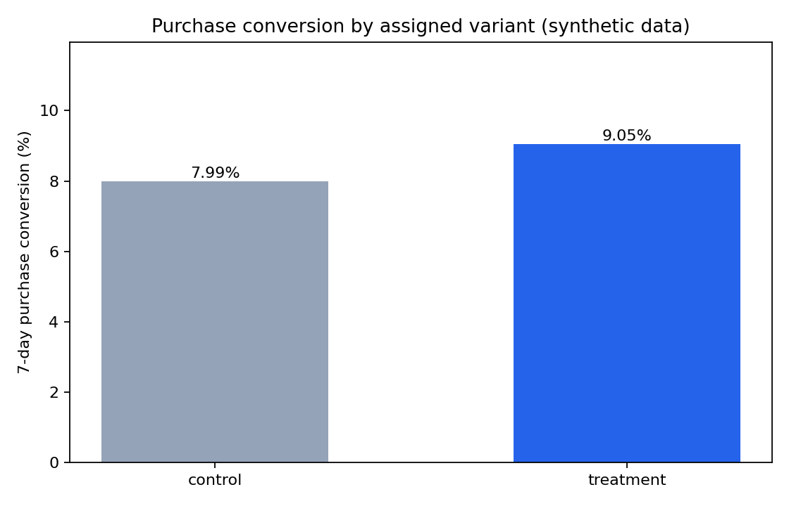
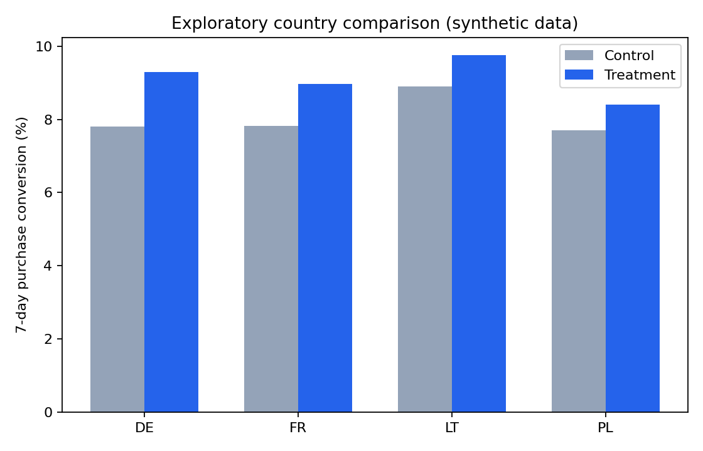

# Marketplace A/B Testing — Product Experimentation with Python & PostgreSQL

**A reproducible case study of a marketplace feature experiment, from a business hypothesis to a statistical decision.**

> **Independent educational portfolio project.** The dataset is entirely **synthetic and generated by the included Python code**. It is not Vinted data, and the measured effect is deliberately simulated rather than an observed business result.

## Business scenario

A second-hand marketplace is considering a new entry point for personalised item recommendations. The product team asks: **does the treatment increase the proportion of users purchasing within seven days?** A randomized experiment assigns users to the current experience (**control**) or new experience (**treatment**).

### Analysis plan

| Element | Definition |
|---|---|
| Unit of randomization | User (`user_id`) |
| Assignment | 50/50, fixed before outcomes |
| **Primary metric** | 7-day purchase conversion (`purchased_7d`), per assigned user |
| Null hypothesis | Treatment conversion = control conversion |
| Alternative | Treatment conversion ≠ control conversion (two-sided) |
| Statistical method | Two-proportion z-test and unpooled 95% confidence interval |
| Significance level | 0.05 |
| Secondary metrics | Listing click-through, gross order value per assigned user |
| Guardrail | Refunds per purchaser (descriptive only) |
| Exploratory analysis | Breakdown by country (not adjusted for multiple testing) |

The analysis includes **all randomized users**, avoiding post-treatment filtering that could bias the primary comparison. The synthetic generator intentionally builds in a small positive treatment effect so this repository illustrates the workflow; it does not provide evidence that a real product feature would work.

## Results from the synthetic experiment

The included run creates **30,000 users**, with **15,000 assigned to each variant**. Running `python src/analyze_experiment.py` produces exact observed rates, a p-value and 95% confidence interval in `outputs/experiment_results.json`, along with comparison charts.





**Business decision:** Treat the statistical results as a demonstration of how to decide whether to progress from an experiment to a staged rollout. A real launch would also require measurement instrumentation checks, a sufficient experiment duration, guardrail review, a predefined minimum detectable effect, and independent validation.

## Key analytical considerations

1. **Randomization unit:** Each user appears once; unique `user_id` values are validated.
2. **Primary metric:** Binary purchase within seven days. Denominator is *all users assigned to each variant*, not only those who clicked.
3. **Sample ratio mismatch:** The SQL query checks whether assignment matches the planned 50/50 allocation.
4. **Baseline balance:** Prior purchasing history is observed before assignment and can be compared across variants.
5. **Statistical uncertainty:** Report absolute lift (percentage points), relative lift, confidence interval, and two-sided p-value; not just a yes/no claim.
6. **Secondary metrics:** Order value per randomized user is descriptive. Refunds per purchaser can suffer from post-treatment selection and must be interpreted cautiously.
7. **Segmentation:** Country analysis is exploratory. Small subgroups and multiple testing can create misleading patterns.
8. **Synthetic-data limitation:** Because outcomes were generated with a specified treatment effect, real-world causality, marketplace seasonality and instrumentation are not tested here.

## Repository layout

```text
marketplace-ab-testing-experiment/
├── data/
│   └── experiment_users.csv             # Generated synthetic dataset
├── sql/
│   ├── 01_create_table.sql              # PostgreSQL table and COPY instructions
│   └── 02_analysis_queries.sql          # Five business / quality-check queries
├── src/
│   ├── generate_data.py                 # Seeded randomized experiment generator
│   └── analyze_experiment.py            # Statistical inference and plots
├── outputs/
│   ├── conversion_by_variant.png
│   ├── conversion_by_country.png
│   ├── variant_summary.csv
│   ├── country_exploration.csv
│   └── experiment_results.json
├── tests/
│   └── test_experiment.py
├── requirements.txt
├── .gitignore
└── README.md
```

## Run locally

Requires Python 3.10+.

```bash
python -m pip install -r requirements.txt
python src/generate_data.py
python src/analyze_experiment.py
python -m pytest -q
```

The scripts are independent of the operating-system working directory because they locate files relative to their own paths. Random generation is reproducible with seed `20261122`.

### Optional PostgreSQL workflow

Create a database, then open `psql` from the repository root and run:

```sql
\i sql/01_create_table.sql
\copy experiment_users FROM 'data/experiment_users.csv' WITH (FORMAT csv, HEADER true)
\i sql/02_analysis_queries.sql
```

This is an alternative SQL analysis workflow; the Python statistical calculations run directly on the generated CSV and do not require a database connection.

## Dataset dictionary

| Column | Meaning |
|---|---|
| `user_id` | Unique synthetic user |
| `variant` | Randomized control or treatment assignment |
| `country` | Simulated country code |
| `device` | Simulated device category |
| `prior_buyer` | Pre-experiment purchase history flag |
| `clicked_listing` | Whether a listing was clicked during measurement window |
| `purchased_7d` | **Primary outcome:** purchase within seven days |
| `order_value_eur` | Simulated gross order value; zero for non-purchasers |
| `refunded_7d` | Simulated refund flag among purchasers |

## Learning outcomes

- Translate a product question into a measurable experiment and hypothesis.
- Generate, clean, validate, and aggregate user-level event data with **pandas**.
- Write **PostgreSQL** queries with `GROUP BY`, window functions, and `NULLIF`.
- Compute **two-proportion z-tests**, confidence intervals, and effect sizes using **SciPy**.
- Visualize primary and exploratory results with **Matplotlib**.
- Explain why statistical significance alone is insufficient for a rollout decision.

## Limitations and next steps

- Experiment assignment is synthetic and exactly balanced; production pipelines have missing events, bots, attrition, and sample-ratio mismatches.
- The generation process assigns a known effect, so this is **not independent evidence** of feature impact.
- Only one 7-day outcome is generated per user; the dataset does not contain a realistic event timeline.
- No power calculation, sequential monitoring correction, or multi-metric correction is implemented.
- Before using this framework on genuine data, define monitoring windows, data quality checks, privacy safeguards, and preregistered decision rules.

## Author

**Tamara Yegorova** — Master's student in Artificial Intelligence in Computer Science, Kaunas University of Technology.  
[GitHub profile](https://github.com/tamyeg)
